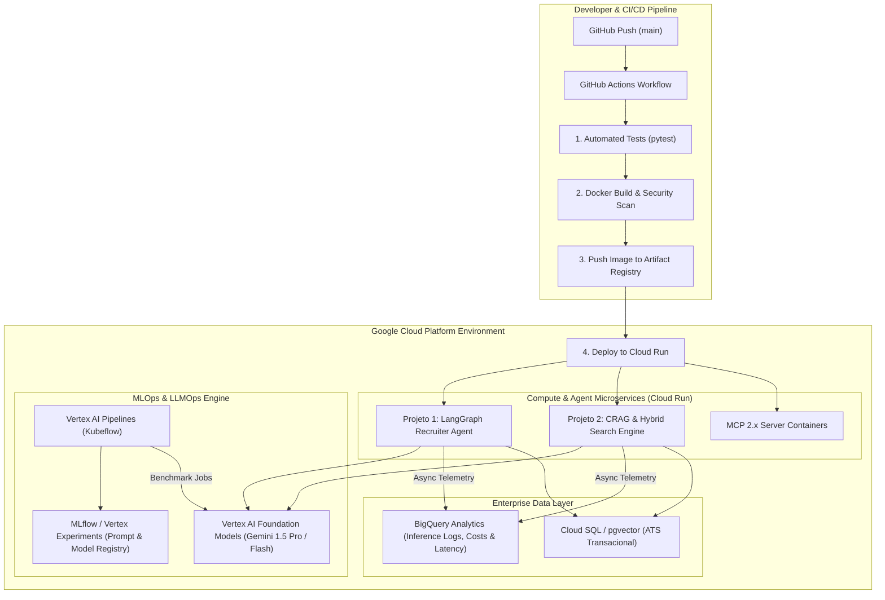

# Enterprise MLOps & LLMOps Platform on Google Cloud (GCP)

Plataforma de infraestrutura de **MLOps & LLMOps para IA Generativa na Google Cloud Platform (GCP)**, projetada para operacionalizar, versionar, monitorar e implantar em produção os sistemas de **Agentes Autônomos (Projeto 1)** e **Engine de Busca Técnica / CRAG (Projeto 2)**. A plataforma estabelece pipelines automatizados com **Vertex AI Pipelines (Kubeflow)**, servidores de microsserviços containerizados no **Cloud Run**, rastreamento de custos e inferências no **BigQuery**, e pipelines de CI/CD automatizados via **GitHub Actions** alinhados às melhores práticas da arquitetura GCP.

---

## Competências Técnicas e Arquitetura da Plataforma

* **GCP Cloud Native Infrastructure**:
  * **Serverless Agent Microservices**: Containerização de microserviços e servidores **MCP (Model Context Protocol)** em contêineres Docker hospedados no **Google Cloud Run** com auto-scaling ($0 \to N$).
  * **Enterprise Data Warehouse & Relational Storage**: **BigQuery** como repositório analítico para histórico de inferências, rastreabilidade de custos e logs de telemetria; **Cloud SQL (PostgreSQL com pgvector)** para persistência de transações ATS e vetorização.
* **Pipelines de Experimentação & LLMOps**:
  * **Vertex AI Pipelines (Kubeflow)**: Orquestração de workflows automatizados para avaliação contínua, benchmarking de novos prompts e testes de regressão de LLMs.
  * **MLflow & Vertex AI Experiments**: Gestão e versionamento de artefatos de modelo, configurações de hiperparâmetros, versões de prompts (*prompt registry*) e matrizes de avaliação de métricas (Ragas / TruLens).
* **Observabilidade, Custos e Guardrails**:
  * Captura assíncrona de telemetria de chamadas aos modelos (tokens de entrada/saída, latência por nó do grafo e custos financeiros exatos por requisição) persistidos no BigQuery.
* **CI/CD Automatizado via GitHub Actions**:
  * Pipeline completo de entrega contínua que executa testes unitários/integrados, constrói imagens no **Artifact Registry**, e realiza deploy automatizado sem downtime (*zero-downtime deployment*) no Cloud Run ao realizar push na branch `main`.

---

## Diagrama da Arquitetura MLOps & Deployment Flow



---

## Detalhamento dos Componentes da Plataforma

### 1. Infrestutura Serverless no Cloud Run (`infrastructure/docker/`)
Os agentes do LangGraph e os servidores MCP são empacotados em imagens Docker otimizadas multi-stage. O deploy no Cloud Run garante alta disponibilidade, concorrência e escalabilidade automática de zero a centenas de instâncias sob demanda.

### 2. Vertex AI Pipelines & MLflow (`mlops/pipelines/`)
Workflow baseado em SDK do Kubeflow (KFP) executado nativamente no **Vertex AI Pipelines**:
* **Prompt Versioning**: Todo ajuste em prompts de avaliação é registrado e testado contra um conjunto de dados de referência (*golden dataset*).
* **Automated Evaluation Gate**: O pipeline só autoriza a promoção de um novo conjunto de prompts para produção se as métricas de *Faithfulness* e *Answer Relevance* mantiverem-se acima do limite estabelecido ($\ge 0.95$).

### 3. Armazenamento Transacional e Telemetria no BigQuery (`src/telemetry/`)
Cada transição de nó nos grafos dos Projetos 1 e 2 emite um evento de telemetria enriquecido:
* `request_id`, `thread_id`, `node_name`
* `input_tokens`, `output_tokens`, `estimated_cost_usd`
* `latency_ms`, `llm_provider`, `model_version`
Estes dados são ingeridos no BigQuery via chamadas assíncronas em lote (*streaming inserts*), alimentando painéis de controle de custos e performance no Looker Studio.

### 4. Pipeline de CI/CD Automatizado (`.github/workflows/deploy.yml`)
Fluxo de implantação acionado via acoplamento nativo com **Workload Identity Federation (GCP)**, eliminando a necessidade de chaves de conta de serviço salvas como segredos estáticos no GitHub:
1. Autenticação na GCP via Workload Identity.
2. Execução das suítes de testes automatizados com cobertura total.
3. Build e marcação das imagens Docker com a tag da versão/commit.
4. Push para o **GCP Artifact Registry**.
5. Deploy com atualização transparente no **Cloud Run**.

---

## Estrutura do Repositório

```text
gcp-llmops-platform/
├── .github/
│   └── workflows/
│       └── deploy.yml           # Pipeline de CI/CD para deploy na GCP via Actions
├── Dockerfile                   # Build multi-stage para microserviços e MCP Servers
├── pyproject.toml               # Dependências do projeto (GCP SDK, KFP, MLflow)
├── requirements.txt             # Requisitos compilados para o container
├── .env.example                 # Configurações de ambiente para GCP Project e Vertex AI
├── README.md                    # Documentação técnica e arquitetura do sistema
├── infrastructure/
│   ├── terraform/               # Scripts IaC para Cloud Run, BigQuery, Artifact Registry
│   └── docker/
│       └── docker-compose.yml   # Ambiente de emulação GCP local
├── mlops/
│   ├── pipelines/
│   │   ├── eval_pipeline.py     # Definição de Vertex AI Pipelines (Kubeflow)
│   │   └── prompt_registry.py   # Módulo de versionamento de prompts via MLflow
│   └── monitoring/
│       └── bigquery_schema.sql  # Schema para tabelas de telemetria, custos e logs
├── src/
│   ├── config.py                # Leitura defensiva de configurações com Pydantic v2
│   ├── telemetry/
│   │   └── logger.py            # Capturador assíncrono de métricas e custos para o BigQuery
│   └── deploy/
│       └── main_server.py       # Ponto de entrada FastAPI/Cloud Run para invocar agentes
└── tests/
    ├── test_pipeline_kfp.py     # Testes da estrutura dos pipelines do Vertex AI
    ├── test_telemetry.py        # Testes de captura e estimativa de custos de chamadas LLM
    └── test_ci_cd_config.py     # Testes de integridade das especificações do deploy
```

---

## Guia de Instalação e Implantação

### 1. Configuração do Ambiente GCP Local

```bash
# Autenticar no ambiente GCP
gcloud auth login
gcloud config set project SEU_PROJETO_GCP

# Ativar APIs necessárias na GCP
gcloud services enable \
    run.googleapis.com \
    artifactregistry.googleapis.com \
    aiplatform.googleapis.com \
    bigquery.googleapis.com
```

### 2. Execução dos Tests e Build do Container Local

```bash
# Executar a suíte de testes
pytest -v

# Construir imagem Docker do microserviço
docker build -t gcp-llmops-platform:latest .
```

### 3. Execução do Pipeline de Avaliação no Vertex AI

```bash
python -m mlops.pipelines.eval_pipeline
```

---

## Decisões de Design de Engenharia

| **Desafio Tecnológico** | **Solução Adotada** | **Justificativa de Engenharia** |
| :--- | :--- | :--- |
| **Escalabilidade e Custo de Servidores** | Google Cloud Run (Serverless) | Garante escalabilidade automática baseada na demanda de requisições e reduz custos a zero quando sem tráfego ativo (*scale-to-zero*). |
| **Segurança no CI/CD** | Workload Identity Federation | Elimina o uso de Service Account Keys estáticas e reutilizáveis armazenadas no GitHub, adotando tokens de curta duração via autenticação OIDC. |
| **Auditoria e Gestão de Custos LLM** | Ingestão Assíncrona no BigQuery | Permite controle financeiro detalhado e rastreamento de latência por requisição/modelo sem bloquear a resposta do agente ao cliente. |
| **Reprodutibilidade de Experimentos** | Vertex AI Pipelines (Kubeflow) | Garante que alterações em prompts, embeddings ou pipelines de avaliação sejam auditáveis, reproduzíveis e testáveis antes da promoção a produção. |
| **Armazenamento Híbrido** | Cloud SQL (PostgreSQL) + BigQuery | Separa transações operacionais de baixa latência (dados de candidato e estado) do processamento analítico massivo de métricas de IA. |

---

## Licença

Licença MIT. Desenvolvido para sustentação de arquiteturas enterprise de IA Generativa, MLOps e LLMOps na Google Cloud Platform.